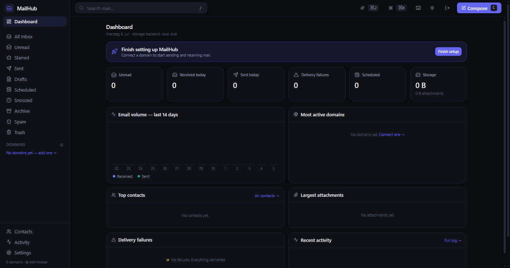
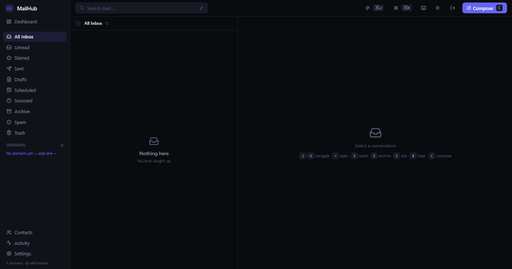
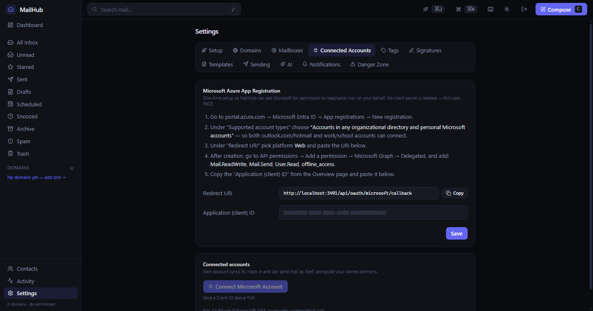

<div align="center">

# 🖥️ MailHub Desktop

**A native Windows app for [MailHub](https://github.com/fleames/mailhub) — no Docker, no separate Postgres install, no terminal.**

[](LICENSE.md)
[](https://www.electronjs.org)
[](#requirements)

Status: **private, pre-launch.** Will be released free and open source.

</div>

---

## What this is

[MailHub](https://github.com/fleames/mailhub) is a self-hosted, single-user
email client — one inbox for every domain you own. It's a Next.js + Postgres
web app, which means running it normally means Docker, environment
variables, and a terminal.

This repo packages that same app as an ordinary Windows program: download,
unzip, double-click, use it. Under the hood it's an Electron shell that:

1. Starts a real embedded PostgreSQL server (via
   [`embedded-postgres`](https://www.npmjs.com/package/embedded-postgres)) —
   no separate database install, data lives in your user profile
2. Runs MailHub's own migrations against it
3. Boots the actual MailHub Next.js server as a child process
4. Auto-logs in and opens the real app in a native window

Nothing about MailHub itself is reimplemented — this repo only adds the
"make it a normal app" layer around the upstream project.

## Screenshots

*Fresh install, right after opening it for the first time — nothing
connected yet.*

<table>
<tr>
<td width="50%">

**Dashboard**



</td>
<td width="50%">

**Unified inbox**



</td>
</tr>
</table>



## Requirements

- Windows 10/11, x64
- To build: Node 20+, [pnpm](https://pnpm.io), and a sibling checkout of
  [`mailhub`](https://github.com/fleames/mailhub) at `../mailhub` (this repo
  vendors that project's build output rather than depending on it as a
  package)

## Building

```bash
pnpm install
```

Then either:

- **Double-click `Build Release.bat`** — rebuilds `mailhub`, syncs it in,
  and packages the app. This is the one-click path; see
  [Build script internals](#build-script-internals) for what it actually
  does and why it's more involved than a plain `electron-builder` call.
- **`pnpm start`** — runs it unpackaged, for development.

Output lands in `dist/win-unpacked/MailHub.exe` (and `dist/*.zip`, a portable
build of the same thing).

### Build script internals

`build-release.ps1` doesn't just call `electron-builder`. In this
development environment, electron-builder can't fully package a fresh build
from scratch without Windows Developer Mode enabled (it downloads a
Windows resource-editing tool as a 7z archive containing symlinks, and
extracting those needs elevated privileges or Developer Mode). Rather than
requiring that for every code change, the script **hot-patches** an
existing `dist/win-unpacked` in place — overwriting just the bundled server
and Electron source — and only falls back to a full `electron-builder` run
when no packaged app exists yet. Pass `-FullRepackage` to force a real
repackage (needed after changing `package.json` dependencies or
`electron-builder.yml`).

## Delivering a build to someone

```powershell
.\package-for-customer.ps1 -Email someone@example.com
```

(or double-click `Package For Customer.bat` and type the email when
prompted). This issues a license, copies the packaged app into a delivery
folder, drops the license file in next to `MailHub.exe`, adds a
`Run MailHub.bat` launcher, and zips it up — ready to send. The app
auto-detects a `*.license` file sitting next to its own exe and activates
with it on first launch; no drag-and-drop, no pasting a key in.

## A note on the license system

`license/` implements a fully offline, Ed25519-signed license/activation
system (see [`license/README.md`](license/README.md) for how it works) —
built when the plan was to sell this as a paid product. That plan has
changed: **MailHub Desktop is launching free.** The activation code is
still in this repo and still runs today, and packaging/delivery still goes
through it (see above) — that hasn't been decided one way or the other yet
for the public release. Flagging it here rather than quietly ripping it out
or quietly leaving it in.

## Architecture

```
electron/main.js       Orchestrates boot: license check → splash → postgres
                        → migrations → bundled server → main window → tray
electron/postgres.js   Embedded Postgres lifecycle (tuned for a single-user
                        desktop workload — small shared_buffers, no
                        parallel workers, JIT off)
electron/server.js     Spawns mailhub's bundled Next.js server as a child
                        process, waits for /api/health, auto-logs in
electron/secrets.js    Generates this install's local secrets once
                        (app password, auth secret, DB password)
license/               Ed25519 license issuing + offline verification
scripts/sync-mailhub.js
                        Copies ../mailhub's standalone build + migrations
                        into vendor/ (gitignored, rebuilt before packaging)
vendor/                The vendored mailhub build (gitignored)
```

## License

GPL-3.0, same as [`mailhub`](https://github.com/fleames/mailhub) itself —
this repo vendors that project's GPL-licensed code, so it can't be licensed
any more permissively than that.
